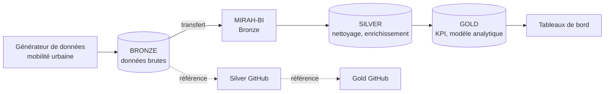

# Senegal Urban Mobility Data

> Projet de référence de génération et de structuration de données de **mobilité urbaine privée (VTC) au Sénégal**, conçu pour alimenter, tester et démontrer la plateforme **MIRAH-BI**.


| | |
|---|---|
| **Projet parent** | MIRAH-BI |
| **Rôle de ce dépôt** | Référentiel technique, documentaire et méthodologique de l'équipe Data |
| **Responsable technique** | Database & Data Engineer, équipe MIRAH-BI |
| **Version du document** | 1.0 |

---

## Table des matières

1. [Contexte](#1-contexte)
2. [Objectifs](#2-objectifs)
3. [Intégration avec MIRAH-BI](#3-intégration-avec-mirah-bi)
4. [Architecture](#4-architecture)
5. [Domaine métier et données générées](#5-domaine-métier-et-données-générées)
6. [Principes de génération des données](#6-principes-de-génération-des-données)
7. [Contrat de la couche Bronze](#7-contrat-de-la-couche-bronze)
8. [Couches Silver et Gold (référence)](#8-couches-silver-et-gold-référence)
9. [Structure du dépôt](#9-structure-du-dépôt)
10. [Démarrage rapide](#10-démarrage-rapide)
11. [Qualité des données et tests](#11-qualité-des-données-et-tests)
12. [Conventions](#12-conventions)
13. [Feuille de route](#13-feuille-de-route)
14. [Contribution](#14-contribution)

---

## 1. Contexte

Le transport urbain privé (VTC et services assimilés) est un secteur en forte croissance au Sénégal, en particulier dans l'agglomération de Dakar. Les données réelles de ces plateformes sont confidentielles et inaccessibles pour le développement et la démonstration d'une plateforme BI.

Ce projet y répond en produisant un **jeu de données synthétique mais réaliste**, fidèle au fonctionnement métier du marché sénégalais, et un **pipeline de référence** pour le structurer.

## 2. Objectifs

Le projet vise à :

- **Générer** des données réalistes de mobilité urbaine privée au Sénégal.
- **Reproduire** le fonctionnement métier des principales plateformes de VTC et de transport urbain opérant sur le marché sénégalais.
- **Construire** une architecture complète Bronze / Silver / Gold servant de référence pour l'équipe Data.
- **Concevoir et valider** des pipelines de données réutilisables dans le cadre de la plateforme MIRAH-BI.
- **Produire** un référentiel métier cohérent pour les besoins de développement, de démonstration et de tests.
- **Mettre à disposition** des jeux de données réalistes permettant de développer de nouveaux cas d'usage analytiques.
- **Servir** de projet de référence pour les futurs développements de la plateforme MIRAH-BI.

## 3. Intégration avec MIRAH-BI

Le dépôt GitHub contient l'**ensemble** du projet (Bronze, Silver, Gold), afin de disposer d'une architecture complète, documentée et maintenable.

Dans le cadre de la plateforme MIRAH-BI, **seules les données de la couche Bronze sont transférées**.

```text
Projet GitHub                      MIRAH-BI
├── Bronze        ───────────►     └── Bronze (uniquement)
├── Silver                              │
└── Gold                                ▼
   (référence technique)            Silver → Gold → KPI → Tableaux de bord
                                    (construits dans MIRAH-BI)
```

### Répartition des responsabilités

| Traitement | Dépôt GitHub | MIRAH-BI |
|---|:---:|:---:|
| Génération des données métier | ✅ | |
| Production de la couche Bronze | ✅ | ✅ (réception) |
| Nettoyage et standardisation | Référence | ✅ |
| Enrichissement des données | Référence | ✅ |
| Transformations métier | Référence | ✅ |
| Calcul des KPI | Référence | ✅ |
| Construction des couches Silver et Gold | Référence | ✅ |
| Tableaux de bord, analyses, visualisations | | ✅ |

> « Référence » signifie que le dépôt documente et implémente l'approche à titre de modèle technique et méthodologique, sans que ces couches soient transférées.

### Principe directeur

Cette approche fait de **MIRAH-BI la plateforme centrale de traitement et d'analyse**, tout en conservant sur GitHub un projet complet servant de **référence technique, documentaire et méthodologique** pour l'équipe Data.

## 4. Architecture



| Couche | Rôle | Principes |
|---|---|---|
| **Bronze** | Données brutes issues du générateur | Aucune transformation métier, métadonnées d'ingestion, historique conservé |
| **Silver** | Données nettoyées et conformées | Typage, standardisation, dédoublonnage, enrichissement |
| **Gold** | Données analytiques | Modèle dimensionnel, agrégats, KPI |

## 5. Domaine métier et données générées

Le périmètre fonctionnel couvre le cycle de vie d'une course VTC. Les entités ci-dessous constituent le référentiel de départ et seront précisées dans le dictionnaire de données (`docs/`).

| Entité | Description |
|---|---|
| **Chauffeurs** | Profil, ancienneté, statut, note moyenne, plateforme(s) d'affiliation |
| **Passagers** | Profil pseudonymisé, ancienneté, fréquence d'usage |
| **Véhicules** | Marque, modèle, catégorie, année, état |
| **Courses** | Demande, acceptation, départ, arrivée, distance, durée, statut |
| **Paiements** | Montant, mode de paiement, commission de la plateforme |
| **Zones géographiques** | Communes et quartiers de l'agglomération dakaroise et principales villes |
| **Évaluations** | Notes et retours passagers et chauffeurs |
| **Incidents et annulations** | Motifs, auteur, moment de l'annulation |

> Les entités exactes, leurs attributs et leurs relations sont à valider avec l'équipe Data avant gel du schéma Bronze.

## 6. Principes de génération des données

Pour rester crédibles et exploitables analytiquement, les données respectent les règles suivantes :

- **Réalisme géographique** : points de départ et d'arrivée cohérents avec le tissu urbain (zones denses, axes principaux, pôles d'activité).
- **Réalisme temporel** : heures de pointe, variations jour de semaine / week-end, saisonnalité.
- **Réalisme économique** : tarification cohérente avec le marché local (prise en charge, distance, durée, majoration en forte demande), en FCFA.
- **Comportements réalistes** : taux d'annulation, délais d'attente, répartition des notes et des modes de paiement plausibles.
- **Cohérence référentielle** : toute course référence un chauffeur, un passager, un véhicule et des zones existants.
- **Reproductibilité** : génération pilotée par une graine (`seed`) et des paramètres de configuration, pour obtenir les mêmes jeux de données à la demande.
- **Volumétrie paramétrable** : du petit jeu de test au volume de démonstration.
- **Protection des personnes** : toutes les données sont **synthétiques** ; aucune donnée personnelle réelle n'est utilisée.

## 7. Contrat de la couche Bronze

La couche Bronze est l'**interface officielle** entre ce projet et MIRAH-BI. Son format est donc stable et documenté.

| Élément | Engagement |
|---|---|
| Contenu | Données brutes, une table ou un fichier par entité |
| Format | À arrêter avec l'équipe MIRAH-BI (CSV, Parquet ou autre) |
| Colonnes techniques | `ingested_at`, `source_system`, `batch_id` |
| Stabilité | Pas de modification de schéma sans préavis ni versionnement |
| Documentation | Dictionnaire de données maintenu dans `docs/` |
| Traçabilité | Chaque lot est identifiable et rejouable |

## 8. Couches Silver et Gold (référence)

Ces couches sont conservées dans le dépôt pour :

- **documenter** les règles de nettoyage, d'enrichissement et de transformation ;
- **valider** la cohérence du modèle sur un jeu de données complet ;
- **fournir un modèle de départ** à reproduire et adapter dans MIRAH-BI ;
- **servir de support** de formation et d'onboarding pour l'équipe Data.

Elles ne sont pas transférées vers MIRAH-BI : leur construction opérationnelle s'y fait directement.

## 9. Structure du dépôt

```text
senegal-urban-mobility-data/
│
├── data/
│   ├── bronze/            # Données brutes (transférées vers MIRAH-BI)
│   ├── silver/            # Données nettoyées (référence)
│   └── gold/              # Données analytiques (référence)
│
├── scripts/               # Génération et pipelines Python
├── sql/                   # Transformations de référence
│   ├── silver/
│   └── gold/
├── config/                # Paramètres de génération et environnements
├── tests/                 # Tests unitaires et contrôles de qualité
├── logs/                  # Journaux d'exécution (non versionnés)
├── docs/                  # Dictionnaire de données, règles métier
│
├── requirements.txt
├── .env.example
├── .gitignore
└── README.md
```

> Adapte cette arborescence à celle réellement présente dans le dépôt.

## 10. Démarrage rapide

### Prérequis

- Python 3.11 ou supérieur
- Git

### Installation

```bash
git clone <url-du-depot>
cd senegal-urban-mobility-data

python -m venv .venv
# Linux / macOS
source .venv/bin/activate
# Windows (PowerShell)
.venv\Scripts\Activate.ps1

pip install -r requirements.txt
```

### Génération et exécution

| Étape | Action | Résultat |
|---|---|---|
| 1 | Configurer les paramètres (volumétrie, période, graine) | Fichier de configuration |
| 2 | Générer les données | Couche Bronze dans `data/bronze/` |
| 3 | Valider la couche Bronze | Rapport de contrôle |
| 4 | Transférer la couche Bronze vers MIRAH-BI | Données disponibles dans MIRAH-BI |
| 5 | (Référence) Exécuter Silver et Gold | Couches de référence dans le dépôt |

Les commandes exactes sont documentées dans `scripts/README.md`.

## 11. Qualité des données et tests

- **Complétude** : champs obligatoires renseignés
- **Unicité** : identifiants sans doublon
- **Intégrité référentielle** : chaque course pointe vers des entités existantes
- **Cohérence temporelle** : heure d'arrivée postérieure à l'heure de départ
- **Plausibilité** : distances, durées et montants dans des plages réalistes
- **Reproductibilité** : une même graine produit le même jeu de données

```bash
pytest tests/ -v
```

## 12. Conventions

| Sujet | Règle |
|---|---|
| Nommage SQL et colonnes | `snake_case` |
| Colonnes techniques Bronze | `ingested_at`, `source_system`, `batch_id` |
| Devise | FCFA (XOF) |
| Fuseau horaire | UTC pour le stockage, GMT/Dakar pour l'analyse |
| Branches Git | `main` (stable), `develop`, `feature/<nom>`, `fix/<nom>` |
| Commits | *Conventional Commits* (`feat:`, `fix:`, `docs:`, `test:`) |
| Code Python | PEP 8 |

## 13. Feuille de route

- [ ] **Phase 1 : Référentiel métier** : entités, règles, dictionnaire de données
- [ ] **Phase 2 : Générateur** : données réalistes et reproductibles
- [ ] **Phase 3 : Bronze** : contrat de format et validation avec l'équipe MIRAH-BI
- [ ] **Phase 4 : Transfert** : chargement de la couche Bronze dans MIRAH-BI
- [ ] **Phase 5 : Référence Silver et Gold** : documentation et implémentation modèle
- [ ] **Phase 6 : Cas d'usage** : nouveaux jeux de données et scénarios analytiques

## 14. Contribution

1. Créer une branche depuis `develop` : `feature/<description>`
2. Respecter les conventions ci-dessus
3. Ajouter ou mettre à jour les tests
4. Vérifier que `pytest` passe
5. Ouvrir une demande de fusion avec une description claire
6. Obtenir une revue avant fusion

---

# Gouvernance

*Projet de référence de l'équipe Data/BI, développé dans le cadre de la plateforme MIRAH-BI.*

**Responsable Technique – Projet MIRAH-BI**

**Plateforme cible : MIRAH-BI**

**SGBD cible : SQL Server**

**Domaine : Mobilité urbaine privée au Sénégal**
